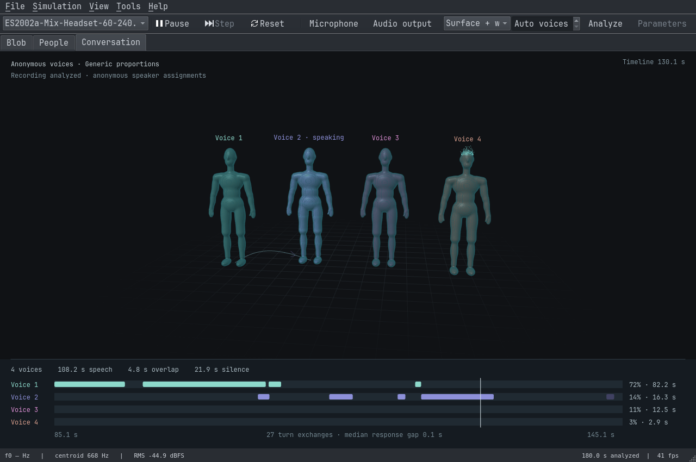
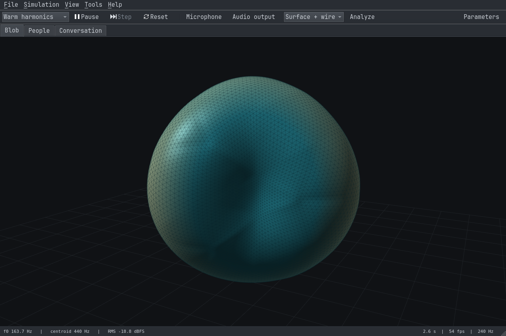
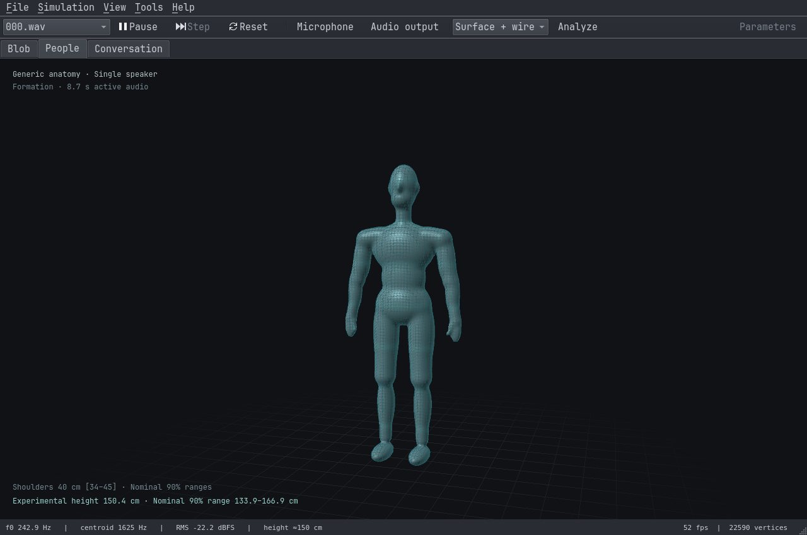

# SONA

A native C++ audio lab for watching sound become shapes, people and conversations.

SONA takes microphone audio or a WAV recording through signal analysis, local models and interactive 3D rendering. It explores a simple question: how much can sound tell us about the people making it?

The project brings the whole workflow into one application: capture, acoustic measurements, experimental physical estimates, speaker tracking, visualization and reproducible evaluation. The models build on existing research; SONA's contribution is the integration, speaker-evidence fusion and the connection between inference and the scene.



*Conversation view, analyzing an AMI meeting excerpt. Figures use generic proportions.*

## Three views

| View | What it does |
| --- | --- |
| **Blob** | A deforming surface driven by pitch, spectral shape and energy. Includes a sound–shape experiment inspired by bouba/kiki research. |
| **People** | A human mesh forms as speech accumulates. Supported experimental height and shoulder-width estimates affect its proportions. |
| **Conversation** | Separate anonymous voices, speech turns, overlap, speaking-time shares and response gaps. The figures and timeline use the same timestamped assignments. |

| Blob | People |
| --- | --- |
|  |  |

Drag to orbit, scroll to zoom, and switch views with `Ctrl+1`, `Ctrl+2` and `Ctrl+3`. Use `Ctrl+R` to start a fresh individual voice profile. Click the conversation timeline to seek through a recording.

## Under the surface

The conversation pipeline combines **Nemotron 3 Diarization** with **pyannote segmentation and TitaNet-S**. A persistent neural speaker cache maintains identities; a background acoustic pass recovers speech regions and aligns its groups with those identities. Both the bars and the people read the resulting segment history.

Runtime analysis and rendering are C++. Qt handles the desktop interface and audio devices; OpenGL handles the scene. CPU and optional CUDA backends run the models locally. Python is used for downloading dependencies, training the experimental trait heads and running evaluations.

The physical estimates are still experimental. The shipped height model comes from the original NISP pilot, and individual errors can be substantial. Displayed uncertainty ranges matter. Conversation figures use generic proportions.

## Build

Tested on Linux x86_64. The base application needs a C++17 compiler, CMake 3.21+, Qt 6.4+ with Multimedia, Widgets, OpenGL, OpenGLWidgets and Concurrent, and OpenGL 3.3.

```sh
cmake -S . -B build -DCMAKE_BUILD_TYPE=Release
cmake --build build -j4
./build/sona
```

This builds the surface simulation and individual voice analysis. For the full conversation pipeline, fetch the pinned models and native runtime first. That setup needs Python 3.12+ and CMake 3.26+:

```sh
python3 research/scripts/fetch_streaming.py
cmake -S . -B build -DCMAKE_BUILD_TYPE=Release \
  -DSONA_NEMOTRON_ROOT=research/cache/nemotron-build
cmake --build build -j4
./build/sona --view conversation --wav recording.wav
```

For CUDA, run the fetch script with `--cuda` and use `research/cache/nemotron-cuda-build` as the runtime root. Keep the voice-count control on **Auto** for persistent tracking. A fixed count selects the older constrained acoustic clustering path.

Recordings, downloaded weights and dependency builds live in the ignored `research/cache/` directory. Model and dataset licenses remain those of their respective authors.

## Research and results

The aim is an integrated audio-to-scene research tool. Each layer has its own evidence: acoustic descriptors, inferred traits, speaker assignments and a visualization that follows those assignments.

Current conversation checks:

| Check | Previous pipeline | Current pipeline |
| --- | ---: | ---: |
| Mean diarization error across three AMI excerpts | 23.9% | 15.1% |
| Diarization error on a 60-second live-protocol replay | 18.8% | 6.3% |
| Speakers found in that replay; reference: four | 2 | 4 |

These are limited integration checks from two AMI meetings. Overlapping speech is included and scoring uses no boundary collar. AMI was used in model pretraining, so these results do not establish performance on unfamiliar recordings. Short or similar voices can still merge.

The [recording measurements](research/results/streaming_native_gpu.json), [paced replay](research/results/streaming_replay.json) and [development comparisons](research/results/streaming_voices.json) are committed alongside the code.

To reproduce the conversation experiments:

```sh
bash research/reproduce_streaming.sh
# Or, with a compatible CUDA toolkit and NVIDIA GPU:
bash research/reproduce_streaming.sh --cuda
```

The [physiology recipe](research/reproduce_physiology.sh) reproduces the NISP experiments and adult-age research. Tests run with `ctest --test-dir build --output-on-failure`.

## References

- [Ćwiek et al. — The bouba/kiki effect is robust across cultures and writing systems](https://doi.org/10.1098/rstb.2020.0390), 2022. Sound–shape inspiration for the original surface experiments.
- [Kalluri et al. — NISP: A Multi-lingual Multi-accent Dataset for Speaker Profiling](https://arxiv.org/abs/2007.06021), ICASSP 2021. Source of the labeled recordings used for SONA's experimental physical-trait models. [Dataset](https://github.com/iiscleap/NISP-Dataset).
- [Kacprzak and Kowalczyk — HeightCeleb](https://arxiv.org/abs/2410.12668), SLT 2024. Related work on speaker embeddings and height estimation; the shipped height model uses NISP.
- [Medennikov et al. — Streaming Sortformer](https://arxiv.org/abs/2507.18446), Interspeech 2025. Arrival-ordered speaker caching for continuous tracking.
- [NVIDIA — Nemotron 3 Diarization](https://huggingface.co/nvidia/Nemotron-3-Diarization), 2026. The pretrained eight-speaker model used by the current pipeline. [Native runtime](https://github.com/NVIDIA/NeMo-Speech.cpp).
- [AMI Meeting Corpus](https://groups.inf.ed.ac.uk/ami/corpus/). Meeting recordings and reference annotations used for evaluation and the conversation screenshot.
